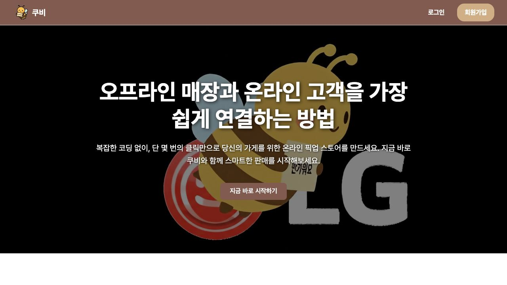
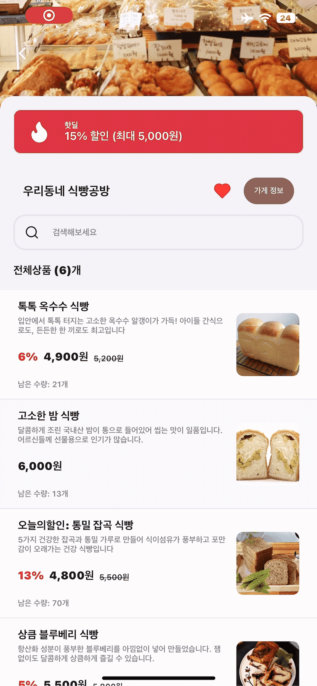
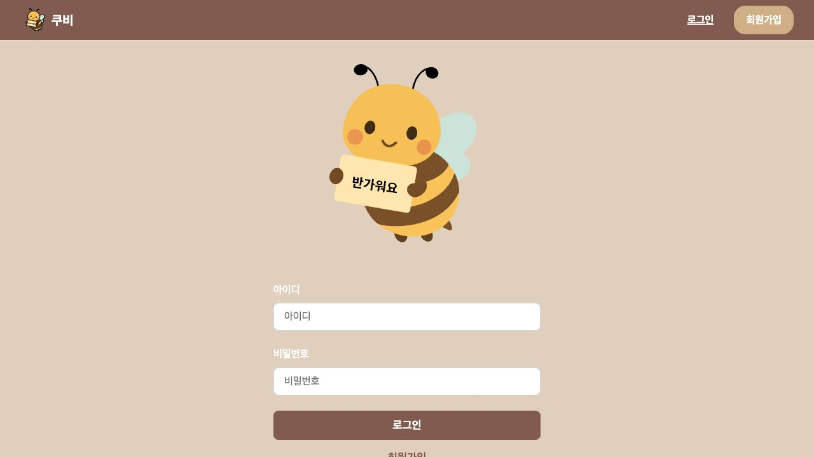
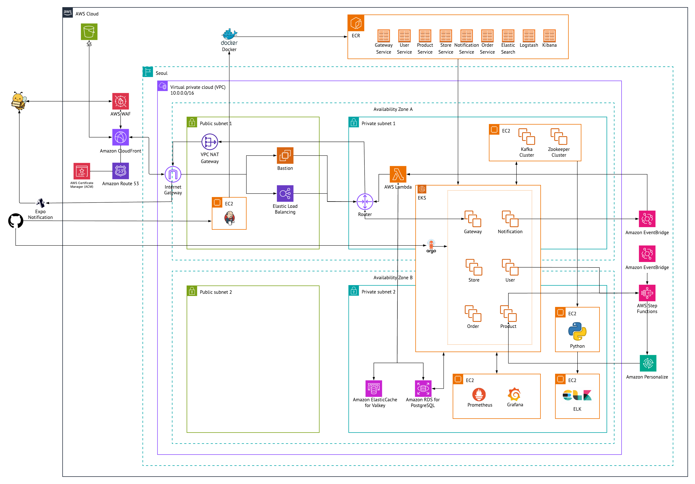

# 🐝 Coubee · 쿠비

동네 상점과 고객을 연결하는 O2O 커머스 서비스입니다.
고객 앱의 상점 탐색·주문·결제와 판매자 웹의 매장·상품·주문·매출 관리를 연결합니다.

## 👨‍💻 역할

- **팀 프로젝트:** LG CNS 팀 4 · Honeycomb
- **담당:** 배포 환경 구성, 테스트 자동화, 성능 검증
## 📂 저장소 구성

프론트엔드 3개, 백엔드 8개, 인프라·연동 3개의 저장소로 구성되어 있습니다.

### 프론트엔드

| 저장소 | 역할 |
| --- | --- |
| [coubee-fe-web](https://github.com/lg-cns-team-4-retail/coubee-fe-web) | 판매자 웹 · React / Vite |
| [coubee-fe-app](https://github.com/lg-cns-team-4-retail/coubee-fe-app) | 고객 앱 · React Native / Expo |
| [coubee-fe-superadmin](https://github.com/lg-cns-team-4-retail/coubee-fe-superadmin) | 운영자 웹 · Vue / Vite |

### 백엔드

| 저장소 | 역할 |
| --- | --- |
| [coubee-be-eureka](https://github.com/lg-cns-team-4-retail/coubee-be-eureka) | 서비스 탐색 |
| [coubee-be-gateway](https://github.com/lg-cns-team-4-retail/coubee-be-gateway) | API 라우팅·인증 |
| [coubee-be-user](https://github.com/lg-cns-team-4-retail/coubee-be-user) | 회원·인증 |
| [coubee-be-store](https://github.com/lg-cns-team-4-retail/coubee-be-store) | 매장·위치 기반 조회 |
| [coubee-be-product](https://github.com/lg-cns-team-4-retail/coubee-be-product) | 상품·검색·추천 API |
| [coubee-be-order](https://github.com/lg-cns-team-4-retail/coubee-be-order) | 주문·결제 |
| [coubee-be-notification](https://github.com/lg-cns-team-4-retail/coubee-be-notification) | 이벤트 기반 알림 |
| [coubee-be-report](https://github.com/lg-cns-team-4-retail/coubee-be-report) | 매출 통계 |

### 인프라·연동

| 저장소 | 역할 |
| --- | --- |
| [coubee-infra-terraform](https://github.com/lg-cns-team-4-retail/coubee-infra-terraform) | AWS 인프라 선언 |
| [coubee-infra-notification-lambda](https://github.com/lg-cns-team-4-retail/coubee-infra-notification-lambda) | 알림 분배·푸시 발송 |
| [coubee-personalize](https://github.com/lg-cns-team-4-retail/coubee-personalize) | 추천 데이터 처리·AWS Personalize 연동 |

## 🛠️ 사용 기술

- **고객 앱:** React Native 0.79, Expo 53
- **판매자·운영자 웹:** React 19, Vue 3, Vite 7
- **백엔드:** Java 17, Spring Boot 3.5, Eureka, API Gateway
- **인프라·배포:** AWS, Terraform, Docker, Kubernetes(EKS), Jenkins, ArgoCD
- **추천·알림:** Python, AWS Personalize, Lambda, EventBridge
- **테스트:** Playwright, JMeter

## 🚀 주요 기능

### 고객 앱 · 상점 페이지

주변 상점과 상품을 탐색하고 주문·결제하는 고객용 앱입니다. 상점 페이지에서는 할인 정보와 상품 목록을 확인하고, 매장 내 상품 검색·관심 상점 등록·가게 정보 조회를 이용할 수 있습니다.

2025년 팀 최종 발표 자료에 수록된 앱 화면입니다.

### 판매자 웹 · 매장 관리

판매자가 매장·상품·주문·매출을 관리하는 웹입니다. 고객 앱에서 발생한 주문을 확인하고 매장 운영에 필요한 정보를 관리합니다.

메인·로그인 화면은 기존 프론트엔드 빌드를 로컬에서 촬영했습니다. 현재 API 연결을 통한 사용자 흐름은 미검증 상태입니다.

### 관리자 페이지 · 서비스 운영

고객 앱·판매자 웹과 분리된 운영자용 웹입니다. 회원과 매장 정보를 조회하고, 매장 승인 등 서비스 운영 업무를 처리합니다.

[관리자 페이지 코드](https://github.com/lg-cns-team-4-retail/coubee-fe-superadmin)

## 🏗️ 시스템 구성

클라이언트와 도메인별 백엔드를 분리하고, AWS 인프라 및 추천·알림 처리로 연결했습니다.

팀 아키텍처 설계도입니다. 현재 운영 자원의 상태를 나타내는 그림은 아닙니다.

## 👨‍💻 담당 작업

### CI/CD · 빌드와 이미지 배포

여러 백엔드 서비스를 공통 절차로 빌드하고 배포하기 위해 Jenkins 파이프라인을 구성했습니다.

- **파이프라인:** 버전 설정 → 애플리케이션 빌드 → Docker 이미지 빌드 → 이미지 푸시
- **팀 공유:** 초기 설정, 도구·자격 증명 등록, 오류 대응 절차를 문서화했습니다.
- **결과물:** 7개 백엔드 서비스에 Jenkins 파이프라인이 남아 있습니다.

[파이프라인 코드 예시](https://github.com/lg-cns-team-4-retail/coubee-be-gateway/tree/main/.jenkins)

### 인프라 · 배포 환경 구성

Terraform·EKS·ArgoCD 기반 배포 환경의 구성과 운영 절차를 정리했습니다.

- **구성 대상:** AWS 인프라 코드와 Kubernetes 배포 환경
- **담당 내용:** 팀원이 환경을 설정하고 운영할 수 있도록 구성 방법과 절차를 문서화했습니다.
- **작업 범위:** 인프라는 팀 공동 결과물이며, 개인 담당 범위는 배포 환경 구성과 관련 문서화입니다.

[인프라 코드](https://github.com/lg-cns-team-4-retail/coubee-infra-terraform)

### 테스트 자동화 · 로그인과 상품 등록

Playwright로 판매자 웹의 핵심 사용자 흐름을 자동화했습니다.

- **로그인:** 계정 입력 → 로그인 → 판매자 화면 이동
- **상품 등록:** 상품 정보 입력 → 이미지 업로드·크롭 → 제출 → 모달 종료 및 목록 반영 확인
- **검증 기록:** 프로젝트 당시 Chromium 실행 결과와 화면 기록을 남겼습니다.

### 성능 검증 · 부하 테스트와 병목 분석

JMeter로 부하를 높이며 **p95 응답 시간·JVM Heap·CPU**를 관찰했습니다. 네트워크, 레플리카, 노드 수를 바꾸어 지연 원인을 조사했습니다.

- **레플리카 증설:** 지연 문제가 해소되지 않았습니다.
- **노드 증설:** CPU 사용량은 감소했으나 지연 한계는 남았습니다.
- **처리 경로 분석:** 상품 검색·추천 API가 공유하는 Python 처리 경로를 후속 검증 대상으로 좁혔습니다.

| 시나리오 | 실측 처리량 | p95 응답 시간 | 오류율 |
| --- | ---: | ---: | ---: |
| RPS-150 | 11.6 req/s | 88 ms | 0.03% |
| RPS-160 | 73.1 req/s | 1,426 ms | 0.00% |

2025년 9월 11일 리포트 기준입니다. 시나리오 이름과 실측 처리량이 달라 최대 처리량이나 동일 조건의 개선율로 해석하지 않습니다.

[실험 과정·원본 리포트](docs/performance.md) · [담당 작업 상세](docs/contributions.md)

## 📌 저장소 및 실행 안내

이 저장소는 프로젝트 소개와 담당 작업을 모은 아카이브입니다. 실행 코드는 **프론트엔드 3개·백엔드 8개·인프라 및 연동 3개**의 원본 저장소에서 확인할 수 있습니다.

- [역할별 원본 저장소 14개](docs/repositories.md)
- [확인한 코드 버전](docs/repo-snapshot.json)
- [팀 프로젝트 소개](https://github.com/lg-cns-team-4-retail/.github/blob/main/profile/README.md)

판매자·운영자 웹의 `npm ci`와 `npm run build` 성공을 확인했습니다. 앱·백엔드 실행과 클라우드 재배포는 진행하지 않았습니다.

[이미지 출처](docs/credits.md)
