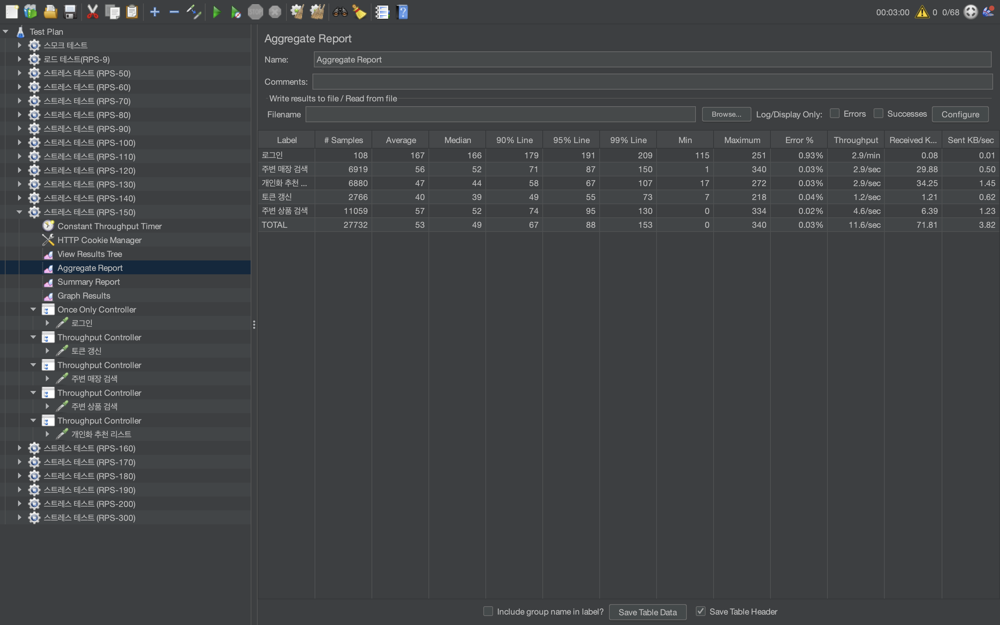
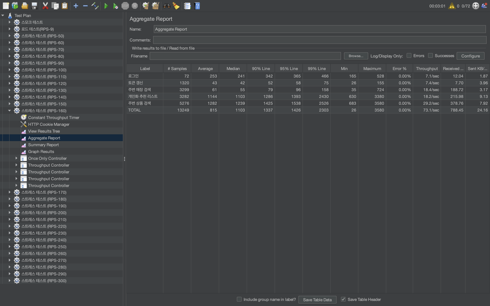

# 성능 검증 기록

[← 프로젝트 소개](../README.md)

JMeter를 이용한 2025년 프로젝트 당시 기록입니다. 트래픽 증가에 따른 응답 지연을 확인하고, 네트워크·서비스 복제 수·노드 수의 영향을 분리해 병목을 조사했습니다.

## 최종 리포트

아래 표는 **2025-09-11 JMeter Summary Report의 TOTAL 행**을 옮긴 값입니다. 부하 시나리오 이름과 실제 리포트의 Throughput은 구분했습니다.

| 항목 | RPS-150 시나리오 | RPS-160 시나리오 |
| --- | ---: | ---: |
| 샘플 수 | 27,732 | 13,249 |
| 평균 응답 시간 | 53 ms | 815 ms |
| 중앙값 | 49 ms | 1,103 ms |
| p90 | 67 ms | 1,337 ms |
| p95 | 88 ms | 1,426 ms |
| p99 | 153 ms | 2,303 ms |
| 오류율 | 0.03% | 0.00% |
| 리포트 Throughput | 11.6 req/s | 73.1 req/s |

두 번째 리포트에서 상품 검색 p95는 **1,538 ms**, 개인화 추천 p95는 **1,393 ms**로 나타납니다. HTTP 오류율이 낮더라도 지연 기준을 충족한다는 의미는 아닙니다.

### RPS-150

### RPS-160

## 원인을 좁힌 과정

| 실험 | 관찰 | 다음 판단 |
| --- | --- | --- |
| 접속 네트워크 변경 | 같은 코드·인프라에서도 결과가 달라짐 | 부하 발생 환경도 비교 조건에 포함 |
| Store·Product 레플리카 1→2 | 지연 문제가 해소되지 않음 | 단순 복제 수 부족 외의 원인 조사 |
| 레플리카를 원복하고 노드 2→4 | CPU 사용량은 감소했으나 지연 한계는 남음 | CPU 여유와 응답 지연을 별개 지표로 관찰 |
| 노드·레플리카를 함께 증설 | 지연 문제가 지속 | 애플리케이션 공통 처리 경로 조사 |
| 상품 검색·추천 경로 분석 | 두 API가 같은 Python 함수를 사용 | 해당 처리의 분산·분리 검증을 후속 과제로 제안 |

인프라 증설만으로 문제가 해결되지 않는 것을 확인하고, 애플리케이션 내부의 공통 처리 경로로 조사 범위를 좁힌 것이 핵심입니다. Python 처리 분산은 당시 일정 내에 적용하지 못했으며, 네트워크 영향도 완전히 배제하지 못했습니다.

## 이전 기록과 비교 범위

- **8월 29일:** 초기 부하 검증과 노드·레플리카 변경 실험. 상세 모니터링이 부족했습니다.
- **9월 4일:** 상품 검색을 제외한 시나리오로 검증했습니다. 최종 시나리오와 요청 구성이 다릅니다.
- **9월 11일:** Smart 검색을 포함해 재검증하고, p95·JVM Heap·CPU와 공통 처리 경로를 분석했습니다.

요청 구성과 네트워크, 리소스 조건이 달라 세 기록을 하나의 동일 조건 전후 비교로 합산하지 않았습니다.

## 수치 해석 범위

시나리오 이름은 `RPS-150`, `RPS-160`이지만 리포트에 표시된 처리량은 각각 11.6, 73.1 req/s입니다. 원시 JTL·실행 설정 전체가 없어 이 차이의 원인을 재현·확정할 수 없습니다. 따라서 **최대 처리량 150 RPS 달성**, **80→200 RPS 개선**, **실제 DAU 수용량**으로 환산하지 않습니다.

이 문서는 남아 있는 리포트와 실험 기록을 정리한 것으로, 현재 운영 환경을 다시 부하 측정한 결과는 아닙니다.
